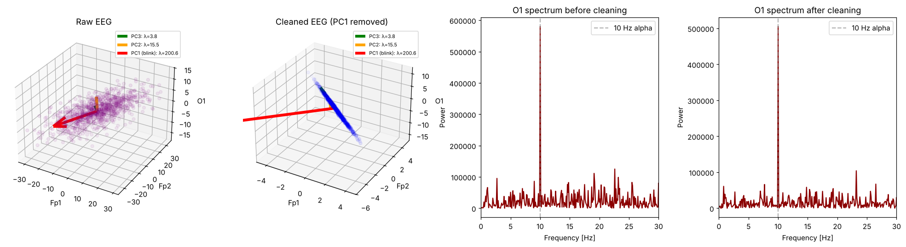

# BrainWaves-BasisVectors

Decoding brain-wave (EEG) data from first principles of linear algebra: **PCA** removes eye-blink artifacts by changing to the eigenbasis of the spatial covariance matrix, and the **Fourier transform** (another change of basis — onto sines and cosines) reveals the 8–13 Hz **alpha rhythm** of a relaxed brain with eyes closed.

Built as a course project for the Programming course at the Kyiv School of Economics (2026).



## Method

$$
\underbrace{A}_{\text{raw EEG}}
\xrightarrow{\text{PCA}} \underbrace{X_{\text{clean}}}_{\text{clean signal}}
\xrightarrow{\text{FFT}} \underbrace{X_k}_{\text{spectrum}}
\xrightarrow{|\cdot|^2} \underbrace{P_k}_{\text{PSD}}
\xrightarrow{8\text{–}13\ \text{Hz}} \alpha
$$

1. **Center** the channels × time matrix and compute the spatial covariance $C = \frac{1}{n-1}\tilde{A}\tilde{A}^T$.
2. **Eigen-decompose** $C\mathbf{v} = \lambda\mathbf{v}$. Unusually large eigenvalues ($\lambda > 10\cdot\mathrm{median}(\lambda)$) are artifacts such as blinks, which hit many electrodes at once.
3. **Change basis** $Y = XV$, zero the artifact components, and return with $X_{\text{clean}} = Y_{\text{clean}}V^T$ (since $V^{-1} = V^T$).
4. **FFT** the occipital channel O1 and compute the power spectrum $P_k = |X_k|^2$, where the alpha peak appears.

The full derivation (in Ukrainian) is in [`docs/`](docs):
[Part 1 — linear algebra & PCA](docs/01-linear-algebra-and-pca.md) ·
[Part 2 — Fourier & spectral analysis](docs/02-fourier-and-spectral-analysis.md).

## Repository structure

```
brainwaves/
  data_loader.py                 Load + 1–40 Hz filter PhysioNet EEGBCI recordings (MNE)
demos/
  pca_3d.py                      3D view of PCA on a toy 3-channel covariance matrix
  full_pipeline_synthetic.py     PCA cleaning + FFT on synthetic data with a 10 Hz alpha wave
notebooks/
  real_eeg_analysis.ipynb        Full pipeline on real 64-channel EEG (Python / NumPy)
  real_eeg_analysis_sage.ipynb   Same pipeline in SageMath
  synthetic_demo_sage.ipynb      Projector P = I − vvᵀ on a predefined covariance (SageMath)
  real_eeg_3ch_sage.ipynb        Same method on 3 real channels: Fc1, Fc2, O1 (SageMath)
docs/                            Mathematical model (UA)
figures/                         Plots produced by the demos
```

## Getting started

```bash
pip install -r requirements.txt

python demos/pca_3d.py
python demos/full_pipeline_synthetic.py
jupyter notebook notebooks/real_eeg_analysis.ipynb
```

The real-data notebooks download subject 1 of the [PhysioNet EEG Motor Movement/Imagery dataset](https://physionet.org/content/eegmmidb/1.0.0/) on first run (run 1: eyes open, run 2: eyes closed). The `*_sage.ipynb` notebooks need a [SageMath](https://www.sagemath.org/) Jupyter kernel.

## Authors

- **Heorhii Martynenko**: PCA and FFT implementation, visualisations, real-data analysis
- **Ivan Udovychenko**: data loading, mathematical model, SageMath analyses
